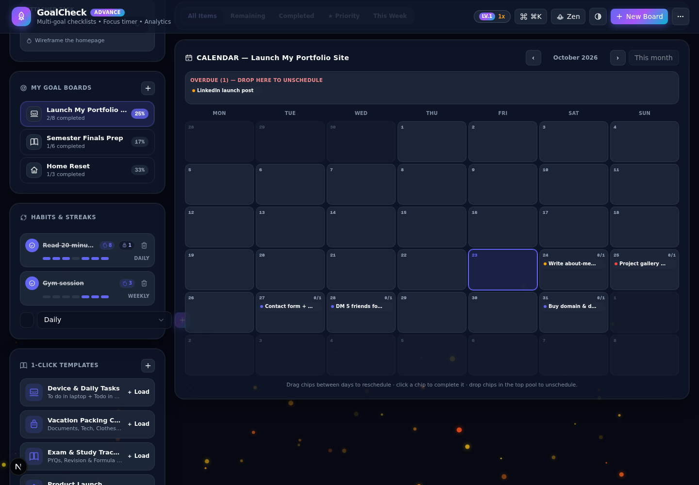
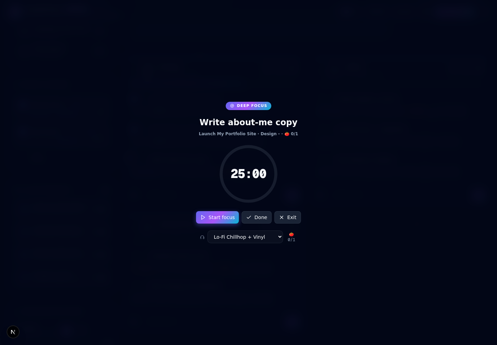

<div align="center">

# ⚡ GoalCheck & GoalCheck Advance

**Local-first multi-goal checklists, focus timer & analytics — no account, no network, no tracking.**

One codebase, two editions. Your data is yours: everything lives in your browser's local storage.

`MIT License` · `No telemetry` · `Works offline` · `Installable PWA` · `Android APK (zero permissions)` · `EN · हिन्दी · ES · DE` · `Built with Next.js 16 + TypeScript`

</div>

---

## What is it?

GoalCheck turns any checklist into a **multi-goal board**: boards → categories → tasks, with progress rings, priorities, notes, micro-steps, dependency locks, recurring categories, rapid-add parsing (`!high` `@today`), and a drift-free Pomodoro focus timer with a floating pill.

**GoalCheck Advance** (default build) adds the power tools: Checklist / Week / **Calendar month grid** (drag a chip to another day to reschedule) / **Roadmap timeline** / Kanban / Eisenhower Matrix / Mind Map / Analytics views, a 365-day activity heatmap, RPG gamification (XP, levels, combo, skills, auras, achievements), habits & streaks, task due dates + **smart recurrence** ("every 2nd Tuesday", weekdays-only), per-goal focus attribution, **per-task time tracking** (manual logs + stopwatch), **Markdown notes with inline checklists**, a global fuzzy search palette (`Ctrl/⌘+K`), **Deep Focus** (a fullscreen one-task overlay), a guided **Weekly Review** ritual, an annual **Year-in-Review Wrapped** card, **importers for Todoist / TickTick / Google Tasks** exports, local due-date reminders (service worker, opt-in), auto-snapshot rotation for the sync file, drag-and-drop everywhere, a demo-data generator, 11 themes, 13 particle engines, atmosphere presets, an audio studio with 7 generative ambient streams, theme JSON sharing, and a Data Doctor for storage integrity.

**GoalCheck (base)** is the calm edition: the core planner, 2 themes, completion confetti — nothing else.

## 🌐 Try it live

**GoalCheck Advance runs right now on GitHub Pages — no install, no account:**

> ### [▶ Open GoalCheck Advance Demo](https://avithegod2010.github.io/Goalcheck/)

*(100% client-side — your demo data never leaves your browser. Export a JSON backup before switching devices.)*

## 📸 Screenshots

**GoalCheck Advance — Checklist** (Nebula dark, heatmap, habits, focus timer)


**Kanban view** — drag & drop across To Do / In Progress / Done


**Calendar view** — month grid with due tasks; drag chips between days to reschedule, drop them in the top pool to unschedule



**Deep Focus** — a fullscreen one-task overlay with its own timer and ambient streams; everything else hidden



**Analytics view** — completion rate, focus time per goal, category workload


**GoalCheck (base)** — the same data, the calm planner edition


## 📱 Install it as an app (PWA)

GoalCheck is an **installable, offline-first PWA**: a web app manifest (per-edition name + icons), a service worker that precaches the app shell, and a custom install card. Once installed it launches full-screen from your home screen / address bar — **and works with the network completely cut off** (the app is 100% client-side, so offline-first is free).

- **Desktop:** Chrome / Edge → install icon in the address bar, or the in-app **Install** card.
- **Android:** Chrome → ⋮ → *Add to Home screen* / the in-app install card.
- **iOS:** Share → *Add to Home Screen*.
- Storage is quota-resilient: if localStorage fills up, the largest embedded images are pruned automatically (with a warning toast + backup nudge) — your tasks, notes and streaks are never dropped.
- **App shortcuts** (Android/desktop PWA): long-press the launcher icon for Week view, Quick-add and Start focus.

## 🌍 Languages

The UI ships in **English, हिन्दी (Hindi), Español and Deutsch** — switch anytime in **Settings → Language** (auto-detected from your browser on first visit). Every locale is key-complete and compile-enforced against the English source catalog, so a missing translation can never ship. Long-form onboarding paragraphs are translated too; only content data (sample tasks, stream names) stays English.

## 🤖 Android app (zero permissions)

A Capacitor shell wraps the same static export into a native APK — and the template's `android.permission.INTERNET` is **removed**, so the OS enforces the no-network promise. CI builds debug APKs for both editions on every `android/v*` tag and attaches them to the release — and once the keystore secret is configured, **signed release APKs + Play-ready AABs** too (versioned from `package.json`). Grab the latest APKs from the [android releases](https://github.com/Avithegod2010/Goalcheck/releases) — zero setup needed.

```bash
bun run build:capacitor:advance   # static export → capacitor/www → cap sync
cd capacitor/android && ./gradlew assembleDebug
# → app/build/outputs/apk/debug/app-debug.apk  (expect ZERO permissions)
```

See [`capacitor/README.md`](capacitor/README.md) for prerequisites and [`download/ANDROID.md`](download/ANDROID.md) for the full build/sign/sideload guide.

## Privacy

> **No data collected. No analytics. No network. Everything stays on your device.**

Full policy: **[privacy.html](https://avithegod2010.github.io/Goalcheck/privacy.html)** (also at `public/privacy.html` in the repo).

- All state lives in `localStorage` on your machine (schema-versioned, with automatic migrations).
- The only optional file access is the **sync-file** feature (Advance): you explicitly pick a local file, and the app writes your backup there. Nothing is uploaded.
- Full JSON export/import anytime — your backup, your disk.
- A full pre-publication security audit is documented in [`download/SECURITY-AUDIT.md`](download/SECURITY-AUDIT.md).

## Two editions, one storage schema

| | GoalCheck (base) | GoalCheck Advance |
|---|---|---|
| Views | Checklist | + Week, Calendar, Roadmap, Kanban, Matrix, Mind Map, Analytics, Deep Focus |
| Themes | 2 (Nebula / Nordic) | 11 + 13 particle engines + presets |
| Extras | — | Habits, achievements, due dates + smart recurrence, time tracking, Markdown notes, weekly review, Year Wrapped, importers, reminders, auto-snapshots, palette, DnD, demo data, templates, audio studio, Data Doctor, theme sharing |

Both editions read the **same storage schema**, so switching between them never loses data — and Advance builds let you switch **inside the app** with the always-visible header switcher (`Normal | Advance` — or Settings → Edition) anytime.

## Run it

```bash
bun install

# Advance edition (default)
bun run dev

# Base edition
bun run dev:base
```

Production:

```bash
bun run build        # Advance
bun run build:base   # Base
bun run start

# Static export for static hosting (GitHub Pages uses this):
BUILD_TARGET=pages NEXT_PUBLIC_GC_EDITION=pro bunx next build
```

Quality gates (run in CI on every push):

```bash
bun run lint         # ESLint
bun run typecheck    # tsc --noEmit (strict)
bunx vitest run      # 92 unit tests
bunx playwright test # 14 E2E golden-path + drag-and-drop tests
```

## Project docs

- [`download/ROADMAP.md`](download/ROADMAP.md) — phase-by-phase roadmap (GitHub → PWA → Android → IzzyOnDroid/F-Droid) and the feature backlog
- [`download/REPO-STRATEGY.md`](download/REPO-STRATEGY.md) — why one monorepo hosts both editions, tag scheme & release flow
- [`download/SECURITY-AUDIT.md`](download/SECURITY-AUDIT.md) — the pre-publication security audit (Q&A format)
- [`CHANGELOG.md`](CHANGELOG.md) · [`SECURITY.md`](SECURITY.md) · [`CONTRIBUTING.md`](CONTRIBUTING.md)
- [`fastlane/`](fastlane/) — store metadata for both Android editions (IzzyOnDroid/F-Droid)
- [`upload/`](upload/) — the original single-file prototype this project was rebuilt from (kept for history, not part of the app)

## Contributing

Issues and PRs welcome. Keep the local-first guarantee: no network calls, no accounts, no trackers — PRs that add outbound traffic will be declined.

## License

[MIT](LICENSE) © 2026 Arnav Nayak (Avithegod2010)
