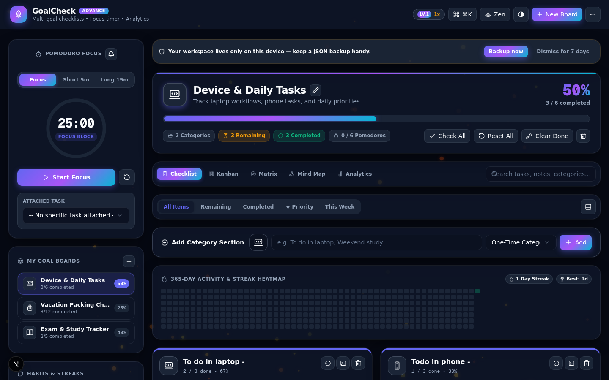
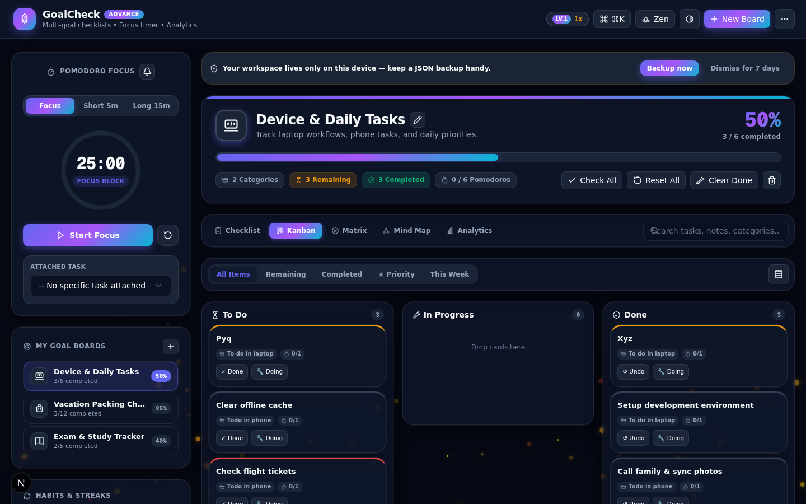
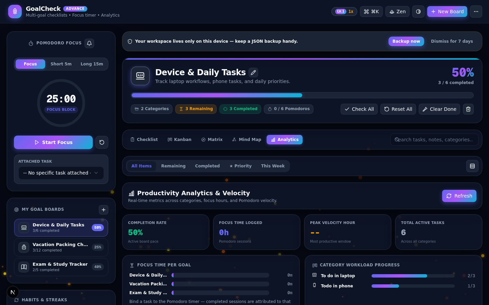
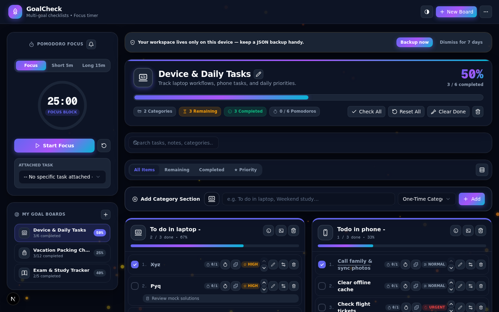

<div align="center">

# ⚡ GoalCheck & GoalCheck Advance

**Local-first multi-goal checklists, focus timer & analytics — no account, no network, no tracking.**

One codebase, two editions. Your data is yours: everything lives in your browser's local storage.

`MIT License` · `No telemetry` · `Works offline` · `Built with Next.js 16 + TypeScript`

</div>

---

## What is it?

GoalCheck turns any checklist into a **multi-goal board**: boards → categories → tasks, with progress rings, priorities, notes, micro-steps, dependency locks, recurring categories, rapid-add parsing (`!high` `@today`), and a drift-free Pomodoro focus timer with a floating pill.

**GoalCheck Advance** (default build) adds the power tools: Kanban / Eisenhower Matrix / Mind Map / Analytics views, a 365-day activity heatmap, RPG gamification (XP, levels, combo, skills, auras, achievements), habits & streaks, task due dates + recurrences, per-goal focus attribution, a command palette (`Ctrl/⌘+K`), Zen mode, goal templates, 11 themes, 13 particle engines, atmosphere presets, an audio studio with 7 generative ambient streams, theme JSON sharing, and a Data Doctor for storage integrity.

**GoalCheck (base)** is the calm edition: the core planner, 2 themes, completion confetti — nothing else.

## 🌐 Try it live

**GoalCheck Advance runs right now on GitHub Pages — no install, no account:**

> ### [▶ Open GoalCheck Advance Demo](https://avithegod2010.github.io/Goalcheck/)

*(100% client-side — your demo data never leaves your browser. Export a JSON backup before switching devices.)*

## 📸 Screenshots

**GoalCheck Advance — Checklist** (Nebula dark, heatmap, habits, focus timer)



**Kanban view** — drag & drop across To Do / In Progress / Done



**Analytics view** — completion rate, focus time per goal, category workload



**GoalCheck (base)** — the same data, the calm planner edition



## Privacy

> **No data collected. No analytics. No network. Everything stays on your device.**

- All state lives in `localStorage` on your machine (schema-versioned, with automatic migrations).
- The only optional file access is the **sync-file** feature (Advance): you explicitly pick a local file, and the app writes your backup there. Nothing is uploaded.
- Full JSON export/import anytime — your backup, your disk.
- A full pre-publication security audit is documented in [`download/SECURITY-AUDIT.md`](download/SECURITY-AUDIT.md).

## Two editions, one storage schema

| | GoalCheck (base) | GoalCheck Advance |
|---|---|---|
| Views | Checklist | + Kanban, Matrix, Mind Map, Analytics |
| Themes | 2 (Nebula / Nordic) | 11 + 13 particle engines + presets |
| Extras | — | Habits, achievements, due dates, palette, Zen, templates, audio studio, Data Doctor, theme sharing |

Both editions read the **same storage schema**, so switching between them never loses data.

## Run it

```bash
bun install

# Advance edition (default)
bun run dev

# Base edition
bun run dev:base
```

Production:

```bash
bun run build        # Advance
bun run build:base   # Base
bun run start
```

Quality gates (run in CI on every push):

```bash
bun run lint         # ESLint
bun run typecheck    # tsc --noEmit (strict)
```

## Project docs

- [`download/ROADMAP.md`](download/ROADMAP.md) — phase-by-phase roadmap (GitHub → PWA → Android → IzzyOnDroid/F-Droid) and the feature backlog
- [`download/REPO-STRATEGY.md`](download/REPO-STRATEGY.md) — why one monorepo hosts both editions, tag scheme & release flow
- [`download/SECURITY-AUDIT.md`](download/SECURITY-AUDIT.md) — the pre-publication security audit (Q&A format)
- [`upload/`](upload/) — the original single-file prototype this project was rebuilt from (kept for history, not part of the app)

## Contributing

Issues and PRs welcome. Keep the local-first guarantee: no network calls, no accounts, no trackers — PRs that add outbound traffic will be declined.

## License

[MIT](LICENSE) © 2026 Arnav Nayak (Avithegod2010)
